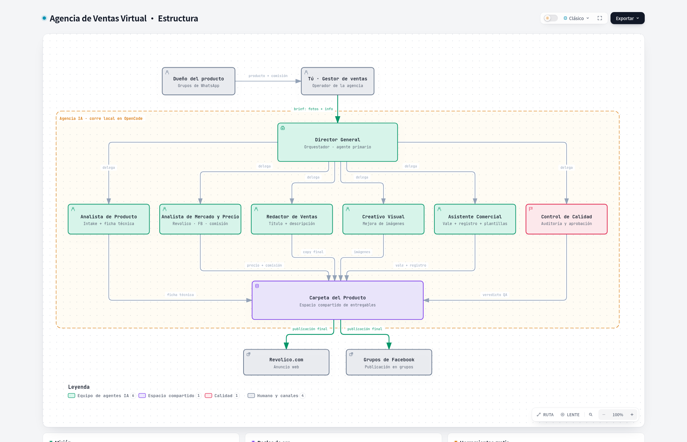

# Agencia de Ventas Virtual + Empresa de Software

**Dos negocios multiagente sobre OpenCode V2: una agencia que convierte productos
crudos en publicaciones listas para vender, y una empresa virtual que convierte
ideas crudas en software corriendo.**

Todo con modelos de IA **gratuitos** (Google AI Studio + OpenCode ZEN), trabajo
colaborativo **por archivos** (auditable y barato en tokens) y gates de calidad
que pueden devolver el trabajo.

> **🇬🇧 Summary (EN).** Two multi-agent businesses built on **OpenCode V2**: (1) a
> 7-role agency that turns raw product info (bad photos + vague descriptions from
> WhatsApp reseller groups) into ready-to-publish listings for Revolico and
> Facebook groups; (2) a 9-role virtual software company (multi-project, no fixed
> stack) that turns raw ideas into running code with independent testing (≥70%
> coverage), regression suite, UX/UI review and a blocking QA gate. Agents
> collaborate through a **file-based shared workspace** (no chat). A local
> **TypeScript plugin** adds a resilient model fallback chain (Google AI Studio →
> two free OpenCode ZEN models) by hooking the session retry event. All models
> are free-tier. Gitflow with protected branches.



*Diagrama interactivo (zoom, temas claro/oscuro, animación de trazas): `docs/arquitectura.html`.*

## Los dos negocios

| Negocio | Entrada | Salida | Dónde |
|---|---|---|---|
| **Agencia de ventas** (7 agentes) | Fotos regulares + descripción vaga de WhatsApp | Paquete listo para Revolico/Facebook | `agencia/` |
| **Empresa de software** (9 agentes) | Una idea cruda | Código corriendo en local (+ Docker/despliegue con tu OK) | `empresa/` + `proyectos/` |

## El problema

Un gestor de ventas en Cuba consigue productos de dueños y proveedores por WhatsApp.
Publicarlos bien (Revolico + grupos de Facebook) exige tiempo y oficio: entender el
producto, comparar precios del mercado, escribir un anuncio que venda, mejorar las
fotos sin mentir y cuidar los datos privados del dueño (precio real y comisión).
Hacerlo a mano, producto a producto, no escala.

Paralelamente, convertir una idea de software en código real exige varios oficios
(investigar el stack, especificar, diseñar, codificar, testear, auditar, desplegar)
que un solo prompt no cubre con calidad. Este repo resuelve ambos con equipos de
agentes especializados.

## La agencia: 7 agentes

Un **Director General** (agente primario) habla con el gestor y reparte el trabajo.
Los otros seis son subagentes que él lanza y supervisa.

| Agente | Rol | Qué entrega |
|---|---|---|
| **Director General** | Orquesta el flujo completo y es el único que habla con el gestor | `brief.md` + paquete final |
| **Analista de Producto** | Mira las fotos y saca los datos reales | `ficha_tecnica.md` |
| **Analista de Mercado y Precio** | Busca comparables y define el precio público aplicando las reglas de comisión | `mercado_precio.md` |
| **Redactor de Ventas** | Escribe títulos y descripciones que venden, en tono cubano | `copy.md` |
| **Creativo Visual** | Mejora las fotos y decide portada y orden (mejorar, nunca falsear) | `visual.md` + `imagenes_finales/` |
| **Asistente Comercial** | Gestiona los vales por dueño, separa datos públicos/privados y arma los mensajes | `vale_venta.md`, `publico.json`, `privado.json`, `registro.md` |
| **Control de Calidad** | Audita el paquete y da veredicto | `qa_reporte.md` (APROBADO o CAMBIOS) |

### Cómo funciona la agencia

**Un producto a la vez.** Cada producto vive en su carpeta
(`agencia/productos/<AAAAMMDD-slug>/`) y el flujo es siempre el mismo:

```
gestor ─▶ Director ─┬─▶ Analista de Producto ────▶ ficha_tecnica.md
                    ├─▶ Analista de Mercado ────▶ mercado_precio.md
                    ├─▶ Redactor de Ventas ─────▶ copy.md
                    ├─▶ Creativo Visual ────────▶ visual.md + fotos finales
                    ├─▶ Asistente Comercial ────▶ vale + público/privado + registro
                    └─▶ Control de Calidad ─────▶ APROBADO / CAMBIOS
                                                     │
                                          CAMBIOS ───┘ vuelve a quien falló
```

## La empresa: 9 agentes

Un **Director Técnico** (agente primario, única autoridad) habla contigo, gestiona
un **portafolio multi-proyecto** y reparte las tareas. Los otros ocho son
especialistas independientes: el que escribe código **nunca** toca los tests y el
que escribe los tests **nunca** toca el código.

| Agente | Rol | Qué entrega |
|---|---|---|
| **Director Técnico** | Única autoridad: portafolio, tareas, historial y reparto | `brief.md`, `tareas.md`, `registro.md` |
| **Investigador de Stack** | Compara 2-3 stacks con documentación actual (Context7 obligatorio) | `investigacion.md` |
| **Analista de Requerimientos** | Convierte la idea en MVP, casos de uso y reglas de negocio | `requerimientos.md` |
| **Arquitecto de Software** | Diseño técnico que el dev debe respetar | `arquitectura.md` |
| **Diseñador UX/UI** | Flujos, pantallas y criterios medibles que QA validará | `diseno_uxui.md` |
| **Desarrollador Fullstack** | Construye el código (nunca toca `tests/`) | `proyectos/<slug>/vN/src/` |
| **Ingeniero de Testing** | Tests independientes + regresión, cobertura ≥70% (nunca toca `src/`) | `tests/` + `test_reporte.md` |
| **Control de Calidad** | Auditor final: funcional + UX/UI + regresión. **Bloquea entregas** | `qa_reporte.md` (APROBADO o CAMBIOS) |
| **DevOps / Documentador** | Local primero; Docker/despliegue **solo con tu OK** | `entrega.md` |

### Cómo funciona la empresa

**Multi-proyecto con versiones aisladas.** Gestión en `empresa/proyectos/<slug>/`,
código en `proyectos/<slug>/vN/` (`vN` no rompe `vN-1`):

```
idea ─▶ Director ─┬─▶ Investigador ──▶ stack ganador (con docs actuales)
                  ├─▶ Analista ──────▶ MVP + CU-01… + reglas
                  ├─▶ Arquitecto ────▶ carpetas, DB, API
                  ├─▶ Diseñador ─────▶ pantallas + criterios medibles
                  ├─▶ Fullstack ─────▶ src/ corriendo en local
                  ├─▶ Testing ───────▶ suite ≥70% + regresión
                  ├─▶ QA ────────────▶ APROBADO (bloqueante) / CAMBIOS
                  └─▶ DevOps ────────▶ entrega local ──tu OK──▶ Docker/despliegue
```

Reglas inviolables (detalle en [`empresa/config/politica.md`](empresa/config/politica.md)):
**R2** separación total dev/testing · **R3** cobertura mínima 70% ·
**R4** QA bloquea sin APROBADO · **R5** despliegue en 2 fases con OK explícito ·
**R6** cero secretos en repo · **R11** código legible en inglés ·
**R12** solo el Director decide · **R13** regresión obligatoria en cada cambio.

**La comunicación es por archivos, no por chat** (en ambos negocios). Cada
subagente lee lo que dejó el anterior y escribe su parte. El Director solo recibe
resúmenes cortos. Esto hace el proceso **auditable** (todo queda escrito), barato
en tokens (cada agente lee solo lo que necesita) y fácil de reanudar si algo se corta.

## Estrategia de modelos y resiliencia

Todo con **capas gratuitas**. El modelo principal es de Google AI Studio y cada
agente tiene cadena de respaldo:

| Orden | Modelo | Proveedor |
|---|---|---|
| Principal | `google/gemini-3.8-flash` | Google AI Studio (capa gratis, con visión) |
| Respaldo 1 | `opencode/big-pickle` | OpenCode ZEN (gratis) |
| Respaldo 2 | `opencode/nemotron-3-ultra-free` | OpenCode ZEN (gratis) |

OpenCode V2 admite **un solo modelo por agente**, sin respaldo nativo. Para cubrir la
cuota diaria de Google (que se agota) escribí un **plugin local en TypeScript**
(`.opencode/plugins/model-fallback.ts`, comentado) que usa la API V2 de plugins:
engancha el evento de reintento de la sesión, clasifica el error (cuota, 429/5xx,
timeout, red) y **cambia el modelo de la sesión al siguiente de la cadena** antes
de reintentar. Si el modelo que falla no está en la cadena, fuerza el primero.
Cubre a los 16 agentes (7 de la agencia + 9 de la empresa).

## Estructura del repositorio

```
AGENTS.md                        # manual del proyecto (agencia + empresa)
.opencode/
  opencode.json                  # modelo por defecto del proyecto (Google)
  agents/*.md                    # los 16 agentes: prompt + modelo + permisos
  plugins/model-fallback.ts      # cadena de respaldo de modelos
agencia/
  README.md                      # guía rápida de uso
  config/politica.md             # reglas de negocio completas
  config/modelos.md              # modelos, respaldo y límites
  plantillas/                    # plantillas de copy, mensajes y ficha de dueño
  productos/_indice.md           # índice de productos
  proveedores/_indice.md         # índice de dueños
empresa/
  README.md                      # guía rápida de uso
  config/politica.md             # reglas inviolables R1-R13
  config/modelos.md              # modelos y cadena de respaldo
  portafolio.md                  # todos los proyectos y su estado
  proyectos/_indice.md           # índice de proyectos
  plantillas/                    # plantillas de los 11 documentos por versión
proyectos/
  <slug>/vN/src/                 # código (solo el dev lo toca)
  <slug>/vN/tests/               # tests (solo testing los toca)
docs/
  arquitectura.png / .html       # diagrama del sistema
  plan-fase-2.md                 # propuesta Fase 2 (harness + API web)
.github/
  CODEOWNERS                     # dueño del repo (revisa todo cambio)
  pull_request_template.md       # plantilla de PR
CONTRIBUTING.md                  # flujo de ramas (Gitflow)
LICENSE                          # MIT
```

> **Nota de privacidad:** el repo es público, así que el trabajo real con datos
> sensibles no se sube: `agencia/productos/<id>/` y `agencia/proveedores/<dueno>/`
> (precios del dueño, comisiones, vales) ni `empresa/proyectos/<slug>/` (docs
> internos) están en `.gitignore`. El sistema (agentes, reglas, plantillas) y el
> código de `proyectos/` sí se versionan. Los secretos jamás entran al repo
> (solo `.env.example`).

## Cómo se monta

1. Instala **OpenCode V2** (app de escritorio o CLI) y conecta un proveedor de
   **Google AI Studio** con su clave (capa gratis).
2. Abre este proyecto. Los agentes y el plugin se cargan solos desde `.opencode/`.
3. Para vender: abre sesión con el **Director General** y mándale el producto
   (fotos + lo que sepas). Te devuelve el paquete listo para copiar y pegar.
4. Para software: abre sesión con el **Director Técnico** y mándale tu idea.
   Te devuelve el proyecto corriendo en local; el despliegue espera tu OK.

## Ramas y flujo de trabajo

Gitflow, con `main` como rama estable y protegida:

| Rama | Para qué |
|---|---|
| `main` | Versión estable / publicable (protegida: sin push directo, todo por PR) |
| `develop` | Integración del trabajo en curso (protegida: sin push directo, todo por PR) |
| `feature/<tema>` | Nueva función o mejora → PR a `develop` |
| `release/<version>`, `hotfix/<tema>` | Cierre de versión y arreglos urgentes (protegidas) |

`main`, `develop`, `release/*` y `hotfix/*` no admiten push directo, ni borrado,
ni reescritura de historial: todo entra por **Pull Request** revisado por el dueño
del repo. Detalle del flujo en [`CONTRIBUTING.md`](CONTRIBUTING.md). El repositorio
tiene además **escaneo de secretos** y **protección de push** activados.

## Reglas de negocio clave (agencia)

- **Comisión inviolable:** si es fija, no se baja nunca (si se puede subir, se avisa
  al gestor); si es libre, la agencia busca el mejor margen razonable.
- **Privacidad:** el precio del dueño, la comisión y sus datos **nunca** salen en la
  versión pública. Los agentes separan `publico.json` (para la UI de clientes, con
  precio final) de `privado.json` (interno).
- **Imágenes:** mejorar, nunca falsear. Se permite recorte, luz, color y limpieza de
  fondo; se prohíbe cambiar el modelo o el color del producto u ocultar daños.
- **Un vale por dueño:** cada dueño tiene su vale; se guarda y se usa el suyo.
- **Honestidad técnica:** los respaldos gratuitos de ZEN no ven imágenes; si Google
  falla en un paso que mira fotos, ese paso se degrada y hay que repetirlo.

## Estado y próximos pasos

- ✅ **Agencia terminada:** los 7 agentes, las reglas, las plantillas, el flujo por
  archivos y la cadena de respaldo de modelos (probada de punta a punta).
- ✅ **Empresa terminada:** los 9 agentes, reglas R1-R13, plantillas y flujo por
  versiones con regresión obligatoria.
- 🔜 **Fase 2 (propuesta en `docs/plan-fase-2.md`):** harness headless + reglas de
  dinero en código testeable + API estable para que la empresa construya la web encima.
- 🔜 **Fase 3:** sistema web propio (catálogo + panel interno) y más canales.

**Límites conocidos:** la agencia no publica sola en Revolico/Facebook (no hay API
pública y automatizar Facebook arriesga bloqueo): entrega todo listo para copiar y
pegar. No cierra la venta ni cobra.

## Notas técnicas

- **Stack:** OpenCode V2 (agentes en Markdown + plugin TypeScript), datos en
  Markdown/JSON, diagramas generados con SVG/HTML.
- **Diseño de prompts:** cada agente tiene un rol cerrado, formato de salida fijo,
  permisos mínimos por archivo y reglas de honestidad explícitas; los gates de
  calidad (Control de Calidad / QA) son reales y pueden devolver el trabajo.
- **Detalles del proyecto en `agencia/config/modelos.md`:** incluye dos hallazgos de
  V2 que costaron encontrar (los subagentes sí heredan su `model:` pero las sesiones
  primarias no; y un `shell: deny` en un agente hace que la capa gratis de ZEN
  rechace las peticiones con 403).
- **Separación de poderes en la empresa:** dev y testing no pueden tocarse el
  código mutuamente ni por permisos ni por reglas; la regresión es obligatoria.

## Licencia

MIT — ver [`LICENSE`](LICENSE).
